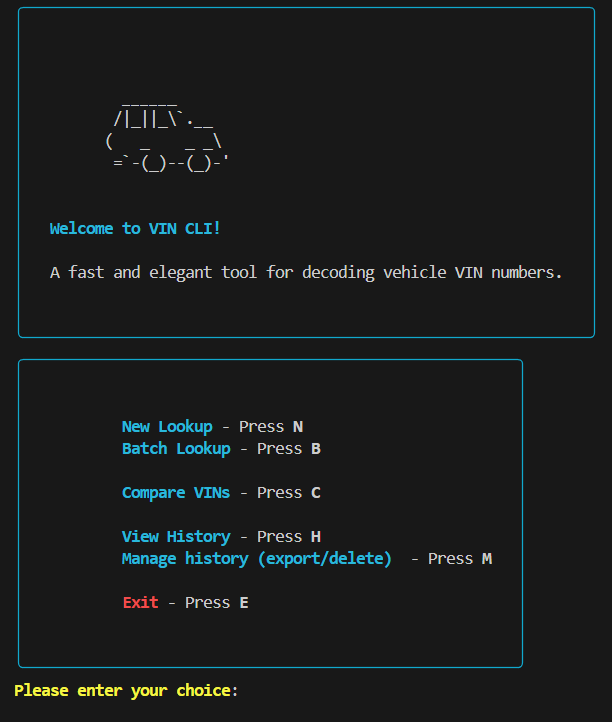

# AutoLookup 🚗

A Python command-line application for decoding and comparing Vehicle Identification Numbers (VINs), checking safety recalls, keeping lookup history, and exporting results.



## Why I built it

AutoLookup started as a personal automotive-data project. I wanted to build a practical Python tool around a domain I already understood, while learning how to structure an application across multiple modules and handle external APIs, validation, caching, exports, and failures cleanly.

## Features

- Single VIN lookup using an external VIN data API
- Batch lookup from a text file
- Side-by-side VIN comparison
- NHTSA safety-recall lookup
- VIN validation (17 characters; rejects I, O and Q)
- Automatic retry with exponential backoff for API failures
- Local lookup history and cached results
- TXT, PDF and Excel exports
- Rich terminal interface
- Rotating application logs for troubleshooting

## Tech stack

- Python
- Requests
- Rich
- Pandas / OpenPyXL
- ReportLab
- Pytest

## Project structure

```text
AutoLookup/
├── autolookup/
│   ├── __main__.py       # Application entry point
│   ├── api.py            # VIN validation, API requests and retry logic
│   ├── display.py        # Terminal output and tables
│   ├── exports.py        # TXT, PDF and Excel exports
│   ├── historyUtils.py   # History and caching
│   ├── inputs.py         # User prompts and menu flow
│   ├── log.py            # Rotating file logger
│   └── manageHistory.py  # History management menu
├── tests/                # Automated tests
├── screenshots/
├── VINS.txt              # Example batch input
├── requirements.txt
└── requirements-dev.txt
```

## Installation

```bash
git clone https://github.com/lukeacko/AutoLookup.git
cd AutoLookup
python -m venv .venv
```

Activate the virtual environment, then install dependencies:

```bash
pip install -r requirements.txt
```

## Run

From the repository root:

```bash
python autolookup/__main__.py
```

A sample `VINS.txt` file is included for trying the batch-lookup feature.

## Tests

Install the development dependencies and run:

```bash
pip install -r requirements-dev.txt
pytest -q
```

The current test suite covers VIN validation, retry behaviour, and history/cache handling without making live API requests.

## Notes

AutoLookup depends on third-party APIs, so live vehicle data availability can change independently of the application. Generated history, logs and report files are excluded from Git.

## Future improvements

- Package the application so it can be run with `python -m autolookup`
- Add mocked API-response tests
- Improve typed data models for API responses
- Add configurable API timeouts/settings
- Expand validation beyond basic VIN format rules

## License

MIT
